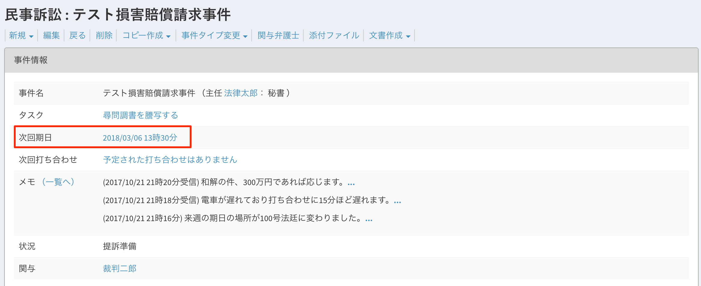

# 予定（期日と打ち合わせ）

期日と打ち合わせを事件や連絡先に紐づけて一括管理できます。  

## 特徴

* 事件や連絡先に紐づけることで、記録（ログ）として保存できます。
* 作成した予定はGoogle Calendarに反映されます（連携が必要です）。
*   CSV出力が可能です。報告書の別紙などとしてご活用ください。

    **使い方**

1 トップページの新規→予定から期日か打ち合わせを選択します２

 \
&#x20;２ 入力フォームに入力します（画像は期日）。 期日の種類も選択できます（書式に反映されます）。\
&#x20;【入力フォーム】  \
&#x20;【作成完了画面】   

３ 事件詳細ページに反映されます。 

4 一覧をクリックすると過去の期日を確認できます

## オフラインでの登録

ホーム画面に追加したfirmeeのアプリからであれば、電波の届かない場所でも期日と打ち合わせの新規登録を行えます。詳しくは[オフライン利用（アプリのインストール）](offline-pwa.md)をご覧ください。

## 繰り返し予定


繰り返し予定の紹介


打ち合わせは、新規作成フォームで繰り返しを指定できます。期日は繰り返しにできません。

プリセットは、毎日・毎週・毎月・毎年・平日です。カスタムでは、間隔と曜日を指定できます。終了日か回数のいずれかの指定が必要で、1つの繰り返し予定は最大100回です。

編集と削除では、「この予定のみ」「これ以降すべて」「すべて」から範囲を選びます。

* 繰り返しを指定できるのは、Webの新規作成フォームだけです。オフライン、MCP、Slack、サポートチャットからの作成は単発です。
* 作成済みの単発の予定は、繰り返しに変更できません。繰り返す場合は、複製して作り直してください。
* 「この予定のみ」の編集では、担当者を変更できません。
* 添付ファイルは、最初の1回にだけ付きます。
* 31日など、その月に存在しない日付になる繰り返しでは、Outlookはその月の月末に寄せ、firmeeとGoogleはその回をスキップします。日付がずれることがあります。
